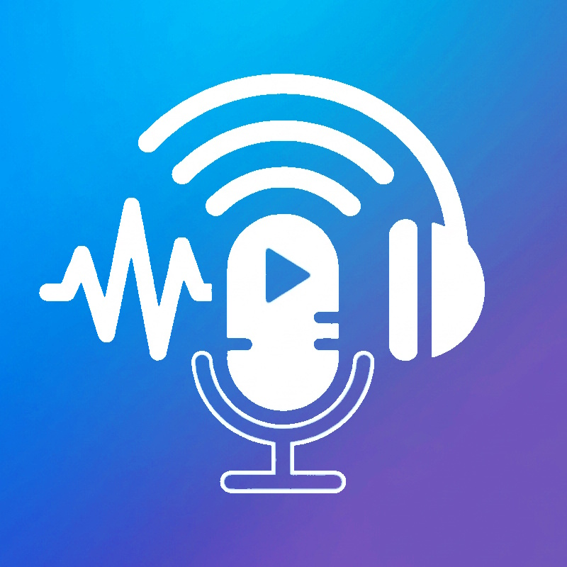

# Castify (キャスティファイ)

<p align="center">
  
</p>

<p align="center">
  <strong>つなぐ、ひろがる、あなただけの電波。</strong><br>
  <em>Tune into the Soundscape.</em><br>
  オープンソースのインターネットラジオ配信スイート「AzuraCast」に対応した、洗練された次世代ストリーミングプレイヤー
</p>

<p align="center">
  
  
  
  
  
  
  
  
</p>

---

## 目次

1. [概要](#概要)
2. [主な機能・特徴](#主な機能特徴)
3. [初回起動チュートリアル & ガイド](#初回起動チュートリアル--ガイド)
4. [使い方ガイド](#使い方ガイド)
   - [1. おすすめチャンネルを探索する](#1-おすすめチャンネルを探索する)
   - [2. 外部 AzuraCast サーバーを追加する（カスタムドメイン）](#2-外部-azuracast-サーバーを追加するカスタムドメイン)
   - [3. マイプレイリスト & お気に入り管理](#3-マイプレイリスト--お気に入り管理)
   - [4. Spotify風 プレイヤー & 配信履歴の確認](#4-spotify風-プレイヤー--配信履歴の確認)
   - [5. チュートリアルを設定画面から再確認する](#5-チュートリアルを設定画面から再確認する)
5. [技術スタック](#技術スタック)
6. [ディレクトリ構成](#ディレクトリ構成)
7. [環境構築・クイックスタート](#環境構築クイックスタート)
   - [前提条件](#前提条件)
   - [1. 依存パッケージのインストール](#1-依存パッケージのインストール)
   - [2. 開発サーバーの起動](#2-開発サーバーの起動)
   - [3. 本番ビルド & 静的書き出し](#3-本番ビルド--静的書き出し)
8. [モバイルアプリ開発 (Capacitor 8)](#モバイルアプリ開発-capacitor-8)
   - [Web アセットの同期](#web-アセットの同期)
   - [Android 実機・エミュレータでのデバッグ](#android-実機エミュレータでのデバッグ)
   - [Android 15 Edge-to-Edge 仕様](#android-15-edge-to-edge-仕様)
9. [クリエイター・運営情報](#クリエイター運営情報)
10. [ライセンス](#ライセンス)

---

## 概要

**Castify（キャスティファイ）** は、世界中の [AzuraCast](https://www.azuracast.com/) インターネットラジオステーションを、どこでも最高の体験で楽しむためのクロスプラットフォーム音楽プレイヤーです。

Webブラウザ（PWA）およびスマートフォンアプリ（iOS / Android）に対応しており、会員登録やログインを必要とせず、アプリを開いた瞬間からクリアなストリーミング放送を楽しめます。

- **途切れない音楽体験**: 画面遷移や別タブのブラウジング中も音楽が止まらないシングルトンオーディオエンジン
- **自由につながるカスタム性**: 自身の AzuraCast サーバーや好きなコミュニティFMのドメインを追加して自分専用のステーション集を作成
- **Spotify ライクな洗練された UI**: アンビエントグラデーション発光、リアルタイム楽曲情報・オンエア状況、配信履歴、Media Session API 完全連動

---

## 主な機能・特徴

| 機能 | 詳細説明 |
| :--- | :--- |
| 📻 **AzuraCast 連携** | AzuraCast REST API と Now Playing データをリアルタイム同期。曲名・アーティスト名・ジャケット写真・リスナー数をリアルタイム取得 |
| 🌐 **カスタムドメイン対応** | 任意の AzuraCast サーバーURL（例: `https://radio.example.com`）を入力するだけで、全配信チャンネルを瞬時に自動インポート |
| 🎵 **スマートミニプレイヤー** | どの画面に遷移しても画面下部に常駐し、再生・一時停止・トラック切り替えがシームレスに行える常駐プレイヤー |
| 🎨 **Spotify風 UI** | アルバムアートワークに連動したアンビエント背景発光、LIVEバッジ、楽曲プログレス表示 |
| 📜 **配信履歴 (History) モーダル** | 過去に流れた楽曲履歴（直近数曲）や次にオンエア予定のトラック（Next Up）、生配信中のDJ情報をいつでも確認可能 |
| 📱 **Media Session API 連動** | Android の通知シェードやロック画面、PCメディアハブにアートワークと曲情報を表示。Bluetooth イヤホン等の物理キー操作に対応 |
| 💡 **画面常時点灯（スリープ防止）** | ラジオをBGMとして据え置き再生する際に便利な、端末のスリープを防止するキープスクリーン機能 |
| 🌓 **システム連動ダークモード** | OS の設定に応じたライト / ダークテーマ自動切り替え & ステータスバーカラー連動 |
| 🚀 **Android 15 Edge-to-Edge** | 最新の Android 15 Edge-to-Edge 仕様に対応し、ノッチや切り欠き、ナビゲーションバーのパディングを自動最適化 |
| 🔰 **初回起動チュートリアル** | 初めてアプリを使うユーザー向けのスライド式4ページチュートリアル。設定画面からいつでも再閲覧可能 |

---

## 初回起動チュートリアル & ガイド

アプリを初めて起動した際、Castify の魅力と使い方をわかりやすく紹介する **4 ページ構成のチュートリアル** が自動で表示されます。

```
┌─────────────────────────────────────────────────────────────┐
│                      Castify チュートリアル                  │
├─────────────────────────────────────────────────────────────┤
│  [Page 1] ようこそ Castify へ                               │
│           ・「つなぐ、ひろがる、あなただけの電波。」        │
│           ・AzuraCast 専用プレイヤーの特徴と概要            │
│                                                             │
│  [Page 2] おすすめチャンネルを探索                          │
│           ・リアルタイムなオンエア楽曲 & リスナー数         │
│           ・ワンタップ即再生 & 途切れないミニプレイヤー     │
│                                                             │
│  [Page 3] 好きなサーバーを追加 (カスタムドメイン)           │
│           ・自身の AzuraCast サーバーや外部 URL を入力      │
│           ・チャンネル一覧の自動取得とマイプレイリスト登録  │
│                                                             │
│  [Page 4] 極上のリスニング体験                              │
│           ・Spotify風 UI、配信履歴 & 次の曲確認             │
│           ・通知バー/イヤホン操作、常時点灯、ダークモード   │
│           ・「Castify をはじめる！」                        │
└─────────────────────────────────────────────────────────────┘
```

- **スワイプ & ボタン操作**: 左右フリックや下部のインジケータードット、「前へ」「次へ」ボタンで快適にスライドを切り替えられます。
- **いつでも再確認可能**: 一度スキップまたは完了した後でも、**設定画面からいつでも何度でも** 呼び出して閲覧できます。

---

## 使い方ガイド

### 1. おすすめチャンネルを探索する
1. ボトムナビゲーションの「**おすすめ**」アイコン（コンパス）をタップします。
2. 公式・厳選された AzuraCast ステーションが一覧表示されます。
3. リアルタイムの曲名、アーティスト名、アルバムジャケット、現在のリスナー数を確認できます。
4. カードまたは再生ボタンをタップすると、即座にライブストリーミングが開始されます。

### 2. 外部 AzuraCast サーバーを追加する（カスタムドメイン・非公開配信対応）
1. ホーム（プレイリスト）画面右下の「**＋**」フローティングボタン（再生バーに被らない親切設計）をタップします。
2. 追加したい AzuraCast サーバーの URL（例: `https://radio.example.com`）を入力します。
3. （オプション）サーバー全体の公開一覧に出ない非公開・限定配信を登録したい場合は、**チャンネルスラッグ**を指定します。スラッグを指定すると、そのチャンネルのみを直接検索して登録できます。
4. 「追加する」をタップすると、チャンネルがマイプレイリストに保存され、次回起動時もすぐに再生できます。

### 3. マイプレイリスト & お気に入り管理
- **ホーム画面**: 登録したすべてのチャンネルをグリッド表示で確認・再生できます。
- **お気に入り（ハート）**: 各カードのハートアイコンをタップすると、お気に入りとしてマークされ、すばやくアクセスできます。
- **削除**: 不要になったチャンネルはゴミ箱アイコンから簡単にプレイリストから除外できます。

### 4. Spotify風 プレイヤー & 配信履歴の確認
- 再生中に画面下部の「ミニプレイヤー」をタップすると、フルスクリーンプレイヤーが開きます。
- **アンビエント発光**: アートワークの色合いに合わせて背景が美しくグラデーション発光します。
- **情報アイコン（ⓘ）**: 右上のインフォメーションボタンをタップすると「ステーション詳細モーダル」が開き、以下を確認できます:
  - 過去にオンエアされた楽曲履歴（Song History）
  - 次に流れる予定のトラック（Next Up）
  - 現在の配信ストリーム品質（ビットレート・コーデック）
  - 生配信中のライブDJ情報

### 5. チュートリアルを設定画面から再確認する
1. ボトムナビゲーションの「**設定**」アイコン（歯車）をタップします。
2. メニュー内の「**チュートリアル**（アプリの使い方・基本操作ガイド）」をタップします。
3. いつでも初回起動時と同じ 4 ページのガイドを振り返ることができます。
4. 右上の「×」ボタンまたは最終ページの「設定画面に戻る」をタップすると、スムーズに設定画面へ復帰します。
   *(※ ボトムナビ右端の「その他」メニューからもチュートリアルを開くことができます)*

---

## 技術スタック

| 分類 | 技術 / ライブラリ | バージョン | 用途・特徴 |
| :--- | :--- | :--- | :--- |
| **Frontend** | [Nuxt 4](https://nuxt.com/) | `4.3.x+` (4.6) | Vue 3 + Vite ベースの最新フルスタックフレームワーク (`future.compatibilityVersion: 4`) |
| **UI Framework** | [Vuetify 3](https://vuetifyjs.com/) | `3.7.x+` | Material Design 3 対応コンポーネントライブラリ (`vuetify-nuxt-module`) |
| **Mobile Bridge** | [Capacitor](https://capacitorjs.com/) | `8.x` | Web アプリを Android / iOS ネイティブアプリとしてビルド・実行 |
| **State Management** | [Pinia](https://pinia.vuejs.org/) | `3.x` | プレイヤー状態、プレイリスト、設定のリアクティブ管理 |
| **Persistence** | `pinia-plugin-persistedstate` | `1.x` | 設定やカスタムドメイン、お気に入りを localStorage へ永続化 |
| **Audio Engine** | HTML5 Audio + Media Session API | Web標準 | シングルトン再生、バックグラウンド再生、ロック画面コントロール |
| **Font & Icons** | Zen Maru Gothic + MDI Font | - | 統一感のあるモダンな丸ゴシック体フォント & Material Design Icons |
| **Styling** | Sass (SCSS) | Embedded | レスポンシブミックスイン (`@mixin mq`) によるモバイル・タブレット・PC最適化 |

---

## ディレクトリ構成

Nuxt 4 標準の `app/` ディレクトリ構造を採用しています。

```
castify/
├── app/                          # Nuxt 4 アプリケーションルート
│   ├── app.vue                   # ルートコンポーネント（テーマ適用、常時点灯、初回起動判定）
│   ├── components/               # Vue コンポーネント群
│   │   ├── about/                # About ページ用ビュー
│   │   ├── common/               # 共通コンポーネント（BottomNav, commonSplash）
│   │   └── player/               # プレイヤー関連（MiniPlayer, StationDetailModal）
│   ├── data/                     # 定数データ（profile.ts, templateInfo）
│   ├── js/                       # ユーティリティ・API 連携スクリプト
│   ├── mixins/                   # Vue ミックスイン
│   ├── pages/                    # ページルーティング
│   │   ├── index.vue             # ホーム（マイプレイリスト & ドメイン追加）
│   │   ├── explore.vue           # おすすめチャンネル探索
│   │   ├── player.vue            # Spotify風 フルスクリーンプレイヤー
│   │   ├── tutorial.vue          # 初回起動・設定再呼び出し対応チュートリアル（4ページ）
│   │   ├── about.vue             # アプリ概要・製作者情報
│   │   └── settings/             # 設定画面群（外観、通知、開発者オプション等）
│   ├── plugins/                  # Nuxt プラグイン（ストレージ復元、PWAエレメント等）
│   ├── stores/                   # Pinia ストア（player, stations, settings, myProfile）
│   ├── types/                    # TypeScript 型定義（azuracast.ts）
│   └── utils/                    # 共通ユーティリティ（azuracast API, keepScreenOn 等）
├── android/                      # Capacitor Android ネイティブプロジェクト
├── assets/                       # SCSS スタイルシート、フォント
├── public/                       # 静的アセット（アイコン、manifest.json、sw.js）
├── capacitor.config.ts           # Capacitor 8 設定ファイル
├── nuxt.config.ts                # Nuxt 4 設定ファイル
├── package.json                  # パッケージ構成 & npm スクリプト
└── README.md                     # 本ドキュメント
```

---

## 環境構築・クイックスタート

### 前提条件
- **Node.js**: `20.x` 以上（LTS 推奨）
- **パッケージマネージャー**: `npm` または `yarn`
- **Android Studio** (Android アプリをビルドする場合): 最新の Android SDK / Command-line Tools

### 1. 依存パッケージのインストール

```bash
# yarn を使用する場合
yarn install

# または npm を使用する場合
npm install
```

### 2. 開発サーバーの起動

```bash
# 開発サーバーを起動 (デフォルトポート: 10000)
npm run dev
# または
yarn dev
```

ブラウザで `http://localhost:10000` を開くと、アプリが起動します。

### 3. 本番ビルド & 静的書き出し

```bash
# SSR / Node 向けプロダクションビルド
npm run build

# Capacitor 用静的アセット生成 (dist / .output/public)
npm run generate
```

---

## モバイルアプリ開発 (Capacitor 8)

Castify は Capacitor 8 により、Web コードベースをそのままネイティブの Android / iOS アプリとして出力できます。

### Web アセットの同期

フロントエンドの静的アセットを生成し、ネイティブプラットフォームと同期します。

```bash
# nuxt generate を実行して native プロジェクトへ sync
npm run cap:sync
```

### Android 実機・エミュレータでのデバッグ

```bash
# Android Studio を起動
npm run cap:open:android
```

Android Studio が起動したら、上部の実行ボタン（▶）を押すだけで接続中の実機またはエミュレータにアプリがインストールされ、起動します。

### Android 15 Edge-to-Edge 仕様
Castify は Android 15 で強制適用される Edge-to-Edge 仕様に対応しています。
- ステータスバーおよびナビゲーションバーの背後までコンテンツを描画しつつ、セーフエリア（ノッチ・カメラ切り欠き）のパディングを自動計算してレイアウト崩れを防止します。
- 開発者オプション（`設定 > 開発者オプション`）から、ステータスバーノッチの表示シミュレーションを切り替えて動作確認が可能です。

---

## クリエイター・運営情報

Castify は、オープンソースコミュニティとインターネットラジオ文化への敬意を込めて開発されています。

- **エノキ電気**
  - 役割: アプリ開発 / サーバー・インフラ構築
  - Webサイト: [https://enoki.xyz](https://enoki.xyz)
  - 運営配信局: [radio.enoki.xyz](https://radio.enoki.xyz)
  - 概要: Web・インフラ・アプリ開発、AI音楽制作などを手がける。

- **ねるる**
  - 役割: ラジオ配信 / コンテンツ・音楽制作
  - Webサイト: [https://architectural-n.net](https://architectural-n.net)
  - 運営配信局: [cast.architectural-n.net](https://cast.architectural-n.net)
  - 概要: インターネットラジオ「ねるるラジオ」「ねるるの日常」等の配信およびオリジナル楽曲を制作。

---

## ライセンス

本プロジェクトはオープンソースとして公開されています。
詳細についてはリポジトリ内のライセンス条項をご確認ください。
